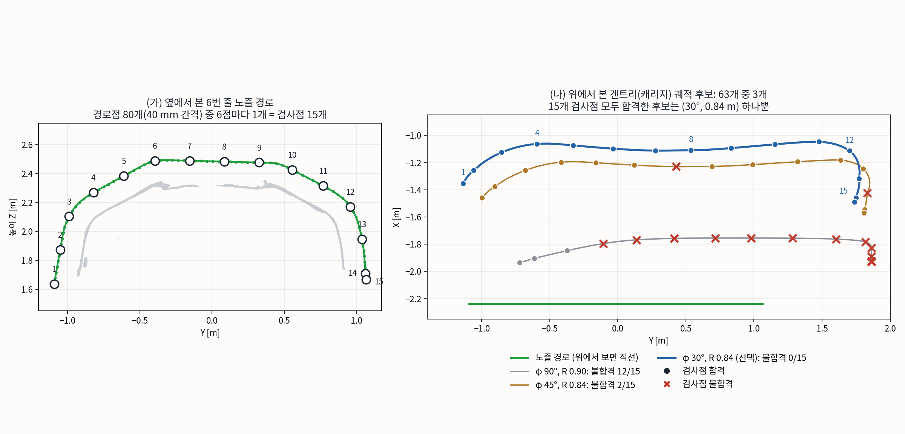
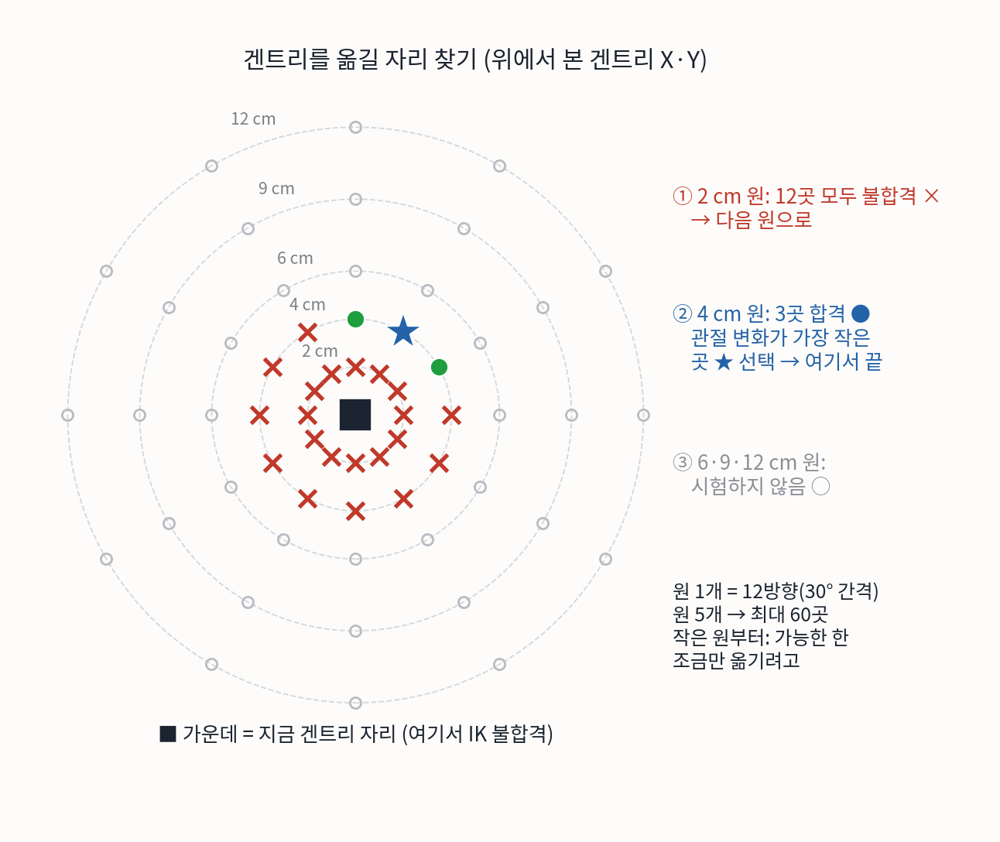

# Gantry Sim: 갠트리 도장 셀 시뮬레이션

갠트리 2축에 두산 A0912 로봇과 스프레이건을 장착하고 자동차 부품의 도장 경로를 ROS 2와 RViz에서 확인하는 연구용 시뮬레이션이다. 범퍼, 좌·우 펜더, 후드, 트렁크의 경로와 미리 계산한 관절 궤적을 재생할 수 있다. 실제 장비를 제어하거나 도장하는 프로그램은 아니다.

## 구성과 방법론

1. **셀 모델링**: 기존 갠트리 메쉬의 레일과 기둥을 늘려 약 8 × 5 × 3 m 시각 모델을 만들고, X/Y 직선 관절, 6축 로봇, 스프레이건과 부품을 URDF로 결합했다. 부품별 URDF는 각 부품의 배치를 정의한다.
2. **경로 입력**: 부품 스캔 형상(PLY)과 위치·자세·분사 상태가 담긴 CSV를 사용한다. CSV 좌표를 부품 배치에 맞춰 변환하고, `publish_path.py`가 RViz 마커로 경로와 분사 상태를 표시한다. 범퍼 일부 경로와 트렁크 순서는 별도 조정된 CSV를 사용한다.
3. **관절 궤적 계산**: 갠트리 위치를 기하학적 규칙으로 정하고 Pinocchio 기반 수치 역기구학으로 로봇 6축 자세를 구한다. 계획 결과는 시간, 관절값과 분사 상태를 포함한 NPZ로 저장한다. 일부 구간은 우회 경로와 속도 제한을 적용한다. 자세한 계산은 [갠트리·로봇 계산 방법](#갠트리로봇-계산-방법)을 참고한다.
4. **충돌 및 재생**: 계획 단계에서 로봇·툴·부품 형상과 갠트리 근사 박스를 사용해 충돌을 검사한다. `planner/play_trajectory.py`가 저장된 관절 상태를 발행하고 `robot_state_publisher`와 RViz가 모델을 표시한다. 충돌은 표본 기반 검사이며 모든 연속 동작의 안전을 보장하지 않는다.

## 갠트리·로봇 계산 방법

범퍼(중앙 밑면 높이 2.31 m, `planner/out_gun_off_231_speed/`) 계획을 기준으로 설명한다. 다른 부품도 같은 플래너 `planner/plan_decoupled.py`를 쓴다.

8축(갠트리 X·Y + 로봇 6축)을 한 식으로 풀지 않는다. **갠트리 위치는 계산식으로 먼저 정하고, 그 위치를 고정한 채 로봇 6축만 IK로 푼다.** 계산은 따로 하지만 결과는 하나의 시간표로 묶여 둘이 함께 움직인다. 갠트리에는 Z축이 없고 레일 높이는 고정이다.

```text
CSV 노즐 목표 (범퍼: 도장 줄 14개, 경로점 938개, 점마다 위치·방향)
  → 손목 위치: 노즐에서 툴 길이 0.431 m만큼 뒤
  → 1단계 (줄 단위): 후보 (φ, R) 63개 중 하나를 골라 그 줄의 갠트리 궤적을 정함
  → 2단계 (점 단위): 갠트리 고정, 로봇 6축 IK + 검사. 불합격이면 그 점에서만 갠트리를 조금 옮김
  → 시간표: 접근·줄 전환·복귀를 붙이고 시간 배분 → t, X, Y, q1~q6, paint
```

### 1. 갠트리 위치 규칙

손목(J5 중심, J4·J5 축의 교점)과 로봇 어깨(J2) 사이 거리가 목표값 R이 되도록, 손목에서 수평 방향 φ로 떨어진 자리에 로봇 베이스를 둔다. IK가 아니라 계산식이라 노즐 목표를 넣으면 갠트리 위치가 바로 나온다. 경로점 i에 대해(줄마다 R, φ는 하나):

$$W_i = p_i + C_i\,r_{\mathrm{tool}}$$

$$h_i = \sqrt{\max\left(R^2 - (z_s - W_{z,i})^2,\ 0.01\right)} + 0.039$$

$$\Delta X_i = 0.2\,u_i^2\,(3 - 2u_i)$$

$$G_i = \mathrm{clip}\left(W_{xy,i} + h_i\,[\cos\varphi,\ \sin\varphi] + \Delta X_i\,[1,\ 0] - b\right)$$

$$\bar{G}_i = \frac{1}{|N_i|}\sum_{j \in N_i} G_j, \qquad N_i = \{\,i-7, \dots, i+7\,\}$$

| 기호 | 뜻 |
|---|---|
| $p_i$, $C_i$ | CSV의 노즐 목표 위치와 방향(회전 행렬) |
| $r_{\mathrm{tool}}$ | 노즐에서 손목까지의 툴 벡터, 길이 0.431 m |
| $W_i$ | 손목 위치 |
| $z_s$ | 어깨(J2) 높이. 레일 높이가 고정이라 상수 |
| $h_i$ | 손목에서 로봇 베이스까지의 수평 거리. 0.039 m는 어깨 오프셋 |
| $\Delta X_i$ | 범퍼의 높은 중앙부에서 +X로 최대 0.2 m 물리는 값(`--center-back 0.2`, 범퍼만). $u_i$는 줄 안 정규화 높이(0 가장 낮음, 1 가장 높음) |
| $b$ | 캐리지에서 로봇 베이스까지의 장착 오프셋(0.313 m) |
| clip | 레일 행정 안으로 자름(예: Y ≤ 1.862 m) |
| $\bar{G}_i$ | 이동평균 15점(앞뒤 7점). 같은 줄 안의 점만 쓰고, 줄 끝에서는 있는 점만 평균. 경로점 간격 40 mm라 약 56 cm 구간 |

예: 0번 줄 첫 분사점(φ 90°, R 0.90 m)

| 단계 | 계산 |
|---|---|
| ① 손목 | 노즐에서 툴 길이 0.431 m만큼 뒤 |
| ② 수평 거리 h | √(0.90² − 0.625²) + 0.039 = 0.687 m (어깨–손목 높이차 0.625 m) |
| ③ 방향 φ | 손목에서 90°(+Y)로 0.687 m → 로봇 베이스 |
| ④ 장착 오프셋 | 로봇 베이스 → 캐리지 0.313 m |
| ⑤ 행정 제한 | 레일 끝(Y 1.862 m)을 넘지 않게 자름 |
| ⑥ 다듬기 | 이동평균 + 중앙부 +X 후퇴 + 국소 보정(아래 4절) → X −2.154 m, Y 1.858 m |

R은 목표값이다. 다듬기와 보정을 거친 뒤 실제 J2–손목 거리는 평균 0.95 m, 범퍼 중앙부 약 1.04 m, 최대 1.070 m로 팔 최대 길이(약 1.076 m)에 가깝다.

### 2. 1단계: 줄마다 갠트리 후보 고르기

R과 φ는 고정값이 아니라 줄마다 후보에서 고른다.

- **후보 63개**: φ = φ₀ + {0, ±15, ±30, ±45, ±60}° (9개) × R ∈ {0.66, 0.72, 0.78, 0.84, 0.90, 0.96, 1.00} m (7개). 범퍼는 φ₀ = 90°(+Y), R₀ = 0.90 m.
- **후보 하나 = 갠트리 궤적 하나**: 후보 (φ, R)를 정하면 위 식으로 그 줄 모든 경로점의 갠트리 위치가 나온다.
- **빠른 선별**: 6점마다 한 점과 마지막 점(예: 6번 줄 80점 → 검사점 15개)에서만 IK를 푼다. 합격 조건은 IK 수렴, 충돌 여유 2 mm 이상, 특이점 아님, 팔 자세 분기(팔꿈치 방향 등) 유지다. 15 mm 여유는 2단계에서 맞춘다.
- **시험 순서**: 직전 줄에서 고른 후보와 비슷한 것부터 시험하고, 처음 값(φ₀, R₀) 쪽으로 약하게 당긴다. 검사점이 모두 합격한 첫 후보를 쓴다.

$$k(\varphi, R) = \frac{|\varphi-\varphi_{\mathrm{prev}}|}{15^\circ} + \frac{|R-R_{\mathrm{prev}}|}{0.06} + 0.3\,\frac{|\varphi-\varphi_0|}{15^\circ} + w_R\,\frac{|R-R_0|}{0.06}$$

$w_R$는 범퍼처럼 시작 자세를 지정한 계획(`--posture photo`)에서 1.0, 그 외에는 0.3이다. 모두 합격한 후보가 없으면 불합격 점이 적은 후보 6개까지 2단계로 시도하고, 그래도 안 되면 점마다 닿는 갠트리 자리를 격자로 찾아 동적계획법으로 잇는다(`dp_gantry`).



6번 줄에서는 63개 중 (30°, 0.84 m) 하나만 15개 검사점을 모두 통과했다. 0번 줄에서 쓴 (90°, 0.90 m)는 15개 중 12개, (45°, 0.84 m)는 2개가 불합격이다. 범퍼에서 고른 값은 다음과 같다.

| 줄 | 0 | 1 | 2 | 3~10 | 11 | 12 | 13 |
|---|---|---|---|---|---|---|---|
| φ | 90° | 60° | 75° | 30° | 75° | 45° | 45° |
| R [m] | 0.90 | 0.78 | 0.90 | 0.84 | 0.90 | 0.84 | 0.90 |

### 3. 로봇 IK: DLS(감쇠 최소제곱)

두산 API의 IK는 쓰지 않고, Pinocchio로 FK와 자코비안을 계산하는 반복 IK를 직접 구현했다(`planner/plan_bumper.py`의 `ArmIK.solve`). 갠트리 값은 고정하고 팔 6축만 푼다.

1. FK: 지금 관절각으로 노즐의 위치·방향을 계산한다.
2. 오차 $e$: 목표 − 현재, 위치 3개 + 방향 3개.
3. 수정: 오차가 줄어드는 쪽으로 관절을 조금 움직인다.
4. 판정: 오차가 충분히 작으면 끝, 아니면 1로 돌아간다.

$$\Delta q = J^\top \left(J J^\top + \lambda^2 I\right)^{-1} e, \qquad \lambda^2 = 10^{-6} + 10^{-3}\,\max\left(0,\ 0.05 - \sigma_{\min}(J)\right)$$

| 제약 | 값 |
|---|---|
| 수렴 기준 | 0.02 mm · 0.001° |
| 최대 반복 | 80번 |
| 한 번 수정량 | 최대 0.4 rad(약 23°) |
| 관절 범위 | URDF 한계 밖으로 못 나가게 자름 |
| 감쇠 λ | 평소 아주 작고, 특이점 근처($\sigma_{\min}$이 작을 때) 커짐 |
| 시작값 | 첫 점은 시작 자세 64개, 이후는 앞 점의 해 |

감쇠가 없으면 팔이 다 펴지거나 손목이 일직선(특이점)에 가까울 때 작은 오차에도 관절이 크게 튄다. 노즐 방향은 분사축 둘레 회전까지 6개 조건을 모두 맞추므로 6축 로봇에 남는 자유도는 없다.

### 4. 2단계: 경로점마다 검사하고 갠트리 국소 보정

1단계에서 고른 궤적을 따라 모든 경로점에서 IK를 풀고 아래 조건을 검사한다.

| 불합격 조건 | 기준 | 처리 |
|---|---|---|
| 충돌 여유 | 경로점에서 15 mm 미만 | ① 밀기 |
| IK 미수렴 | 0.02 mm · 0.001° 아래로 안 줄어듦 | ② 원 탐색 |
| 팔꿈치 자세 | 시작한 팔꿈치 위 자세가 바뀜 | ② 원 탐색 |
| 도장점 J3 | 12° 미만(팔이 다 펴짐) | ② 원 탐색 |
| 도장점 J5 | 15° 미만(손목이 일직선) | ② 원 탐색 |

불합격이면 그 점에서만 갠트리 X·Y를 조금 옮기고 팔을 다시 푼다.

- **① 충돌이면 밀기**: 피할 방향을 알기 때문에 충돌 여유가 커지는 쪽으로 1.5 cm씩, 최대 10번 옮긴다.
- **② 그 외는 원 탐색**: 방향을 모르기 때문에 반경 2 cm 원 위 12방향(30° 간격)을 모두 시험하고, 없으면 4·6·9·12 cm로 넓힌다. 처음 합격 자리가 나온 반경에서 관절 변화가 가장 작은 자리를 고른다.
- **원래 궤적으로 복귀**: 옮긴 양 $\delta_i$는 다음 점으로 85%만 넘긴다($c_{i+1} = 0.85\,\delta_i$). 보정은 점점 줄어 원래 궤적으로 돌아간다. 줄 사이 이동 구간은 보정을 그대로 넘기고 커지는 추세도 반영한다.



점 사이도 확인한다. 앞 점보다 관절이 8° 넘게 바뀌면 사이를 잘게 나누고, 관절 보간한 노즐이 경로에서 1 mm · 0.2° 넘게 벗어나면 중간점을 넣는다. 범퍼의 최종 1,586점은 경로점 938 + 중간점 391 + 줄 전환·접근·복귀 257이다.

범퍼 전체에서 국소 보정은 242회였다. 보정이 다음 점으로 이어지면서 경로점 568/938개(61%)가 영향을 받았고, 규칙 궤적에서 최대 41 cm 벗어났다(13번 줄).

### 5. 시간표와 동시 이동

작업 순서는 `접근 → (도장 → 줄 전환) × 14줄 → 복귀`다.

| 작업 단계 | 갠트리·로봇 |
|---|---|
| 접근(홈 → 도장 시작점) | 따로(갠트리 → 팔) |
| 도장(줄을 따라 분사) | 거의 항상 같이: 점 사이 이동 1,315번 중 1,302번(99%) |
| 줄 전환(다음 줄 시작점으로) | 거의 항상 같이: 251번 중 241번(96%) |
| 복귀(마지막 줄 → 홈) | 대부분 따로 |

멀리 갈 때는 팔 자세를 고정하고 갠트리만 움직여 충돌 위험을 줄이고, 자세를 바꿀 때는 갠트리를 세운 채 팔만 움직인다.

시간은 점 사이마다 가장 느린 축에 맞춘다.

$$\Delta t_k = \max\left(\frac{\lVert \Delta p_k \rVert}{0.5\ \mathrm{m/s}},\ \frac{\lVert \Delta G_k \rVert_\infty}{0.5\ \mathrm{m/s}},\ \frac{\max_j |\Delta q_{j,k}|}{120^\circ/\mathrm{s}}\right)$$

$\Delta p$는 노즐 이동, $\Delta G$는 갠트리 이동, $\Delta q$는 팔 관절 변화다. 가속도는 갠트리 1.0 m/s², 팔 관절 600°/s² 이하로 맞춘다. 마지막으로 `planner/limit_xy_speed.py`가 갠트리 X·Y 합성 속도가 0.5 m/s를 넘지 않도록 시간 전체를 늘린다.

예: 6번 줄 한 칸(0.09초) 동안 노즐 이동 [mm]

| 방향 | 갠트리 | 팔 | = 노즐 |
|---|---|---|---|
| 옆(Y) | 38.5 | 1.5 | 40.0 |
| 앞뒤(X) | −0.5 | 0.5 | 0 |
| 높이(Z) | 0(Z축 없음) | −1.0 | −1.0 |

줄 전체로 보면 옆 이동은 갠트리가, 높이와 방향은 로봇이 맡는다. 짧은 첫 줄은 이동평균 때문에 갠트리가 거의 서 있고 팔만 움직인다. 재생은 `planner/play_trajectory.py`가 8축 값을 초당 50번 `/joint_states`로 보내고 RViz가 표시하는 시뮬레이션이다. 실제 모터와의 동기화는 확인하지 않았다.

### 부품별 결과

모든 부품의 갠트리 X·Y 합성 속도는 최대 0.5 m/s다.

| 부품 | 배치 | 경로점 | 재생 시간 | 결과 디렉터리 |
|---|---|---|---|---|
| 범퍼 | 중앙 밑면 2.31 m | 938/938 | 189.1초 | `planner/out_gun_off_231_speed/` |
| 왼쪽 펜더 | 가장 낮은 점 1.55 m, Y −1.0 m | 240/240 | 57.0초 | `planner/out_part_fender_speed/` |
| 오른쪽 펜더 | 가장 낮은 점 1.55 m, Y +1.0 m(180° 회전) | 307/307 | 76.9초 | `planner/out_part_rfender_speed/` |
| 후드 | 중앙, 경로 중심 높이 1.5 m | 1091/1091 | 139.8초 | `planner/out_part_hood_speed/` |
| 트렁크 | 중앙, 경로 중심 높이 1.5 m | 643/643 | 106.4초 | `planner/out_part_trunk_speed/` |

범퍼 계획 시간은 약 19초이고, 경로점 최소 충돌 여유는 15.03 mm다.

### 한계와 불확실성

- 좌표와 노즐 기준점(TCP)은 실측 보정 전이다.
- 배치에 민감하다. 범퍼는 2.31 m와 2.33 m에서 성공했고 2.28 m부터 실패했다. 충돌 여유를 20 mm·25 mm로 올려도 실패했다.
- 노즐 방향 6개 조건을 모두 고정해 로봇 여유가 없다. 분사축 둘레 회전을 풀어 보는 실험이 다음 과제다.
- 충돌은 경로점(노드)에서만 검사했다. 점 사이 연속 동작은 인증하지 않았다.
- 실제 장비 속도·가속도 한계와 실기 동기화는 확인하지 않았다.

## 실행 환경과 준비

- Ubuntu 및 ROS 2 Humble: `rviz2`, `robot_state_publisher`, `joint_state_publisher_gui`, Python `rclpy`, `sensor_msgs`, `visualization_msgs`가 필요하다.
- Python: NumPy, SciPy, PyYAML. IK 및 충돌 계산에는 Pinocchio, Coal, trimesh도 필요하다. 사용하는 ROS/Python 환경에서 이 모듈들을 사용할 수 있어야 한다.
- 별도로 설치한 `dsr_description2`(A0912)와 `spraygun_description` ROS 패키지가 필요하다. 이 저장소에 해당 패키지는 포함되어 있지 않다.
- 현재 스크립트는 `/home/jhin/doosan_ws/install/setup.bash`와 `/home/jhin/spraygun_ws/install/setup.bash`를 불러오고, URDF는 `/home/jhin/gantry_sim`의 메쉬를 참조한다. 해당 위치에 설치하거나, 다른 환경에서는 쉘 스크립트의 setup 경로와 URDF의 `file:///home/jhin/gantry_sim/` 경로를 실제 위치로 수정해야 한다. 일부 계획 스크립트와 모델 재생성은 기존 프로젝트의 로컬 파일에도 의존한다.

```bash
# 외부 ROS 패키지와 위 의존성을 준비한 뒤 저장소에서 실행
cd /home/jhin/gantry_sim
./run_rviz.sh                  # 슬라이더로 수동 조작
./run_rviz.sh --follow         # 범퍼 전체 계획 재생
./run_rviz.sh --one-row 6      # 범퍼 6번 줄 재생 (0부터 번호)
./run_rviz.sh --first-point on # 첫 경로점 접근 IK 계산 및 재생
./run_parts_rviz.sh            # 5개 부품을 각각 RViz 창으로 재생
./run_parts_rviz.sh bumper hood # 선택한 부품만 재생
```

RViz 창을 닫으면 해당 재생이 종료된다. `run_parts_rviz.sh`의 선택지는 `bumper`, `left_fender`, `right_fender`, `hood`, `trunk`다. 기본 ROS 도메인은 실행 모드마다 분리되어 있다.

## 주요 파일

- `paint_cell*.urdf`, `meshes/`, `*.ply`: 셀 및 부품 시각 모델
- `*/painting_trajectory*.csv`: 부품별 도장 경로 입력
- `planner/cell_model.py`, `planner/plan_bumper.py`: 셀 기구학·충돌 모델, IK(`ArmIK`)
- `planner/plan_decoupled.py`: 갠트리 경로 → 팔 6축 분리 계획(위 계산 방법)
- `planner/limit_xy_speed.py`: 갠트리 X·Y 합성 속도 0.5 m/s 제한
- `planner/out_*_speed/`: 재생용으로 선택한 궤적과 검증 결과
- `run_rviz.sh`, `run_parts_rviz.sh`, `publish_path.py`: 실행 및 경로 시각화

기존 모델 패키지, 원본 모델 생성에 필요한 별도 프로젝트, 발표 자료(계산 설명 그림 2장만 `docs/`에 포함), 디버그 HTML, 캐시 및 중간 실험 결과는 포함하지 않았다. 저장된 결과와 검증 범위는 아래를 참고한다.

## 갠트리 도장 셀 RViz 보기

갠트리·A0912·스프레이건·범퍼와 기존 CSV 경로를 시각화한다.

```bash
./run_rviz.sh
```

ROS 2 Humble과 `/home/jhin/doosan_ws/install`, `/home/jhin/spraygun_ws/install`의 기존 모델 패키지를 사용한다. 슬라이더로 갠트리 X/Y, 로봇 6축, 스프레이건을 움직일 수 있다. RViz를 종료하면 관련 노드도 종료된다. 기본 ROS 도메인은 91이며 `ROS_DOMAIN_ID`로 변경할 수 있다.

## 전체 경로 시각화 실험

낮춘 범퍼의 한 줄만 확인하려면 `./run_rviz.sh --one-row 6`을 실행한다. 범퍼 중앙 밑면 2.08 m의 별도 계획이며 6번 줄(0부터)의 첫 점에서 시작해 마지막 점까지 반복 재생한다. 홈 접근 및 줄 사이 연결은 포함하지 않는다. 다른 줄은 이 배치에서 아직 계산하지 않았다.

```bash
./run_rviz.sh --follow
```

시뮬레이션 범퍼 중앙 밑면 높이 2.31 m, 건 lift 0 mm(수납)를 사용한다. `make_adjusted_path.py`는 원본을 보존한 채 11번 줄의 유난히 긴 시작 구간을 인접한 10·12번 줄에 맞춰 줄인 사본을 생성한다. 원본 0~7번 점 제거(분사 5점 포함), 8~10번 점은 분사 OFF(3점)로 변경하여 분사점 총 8점이 줄어든다. 도장 면적·품질은 별도로 확인해야 한다.

`--follow`는 `planner/out_gun_off_231_speed/`의 계획을 재생한다. 범퍼 중앙부의 높은 지점에서 캐리지를 +X로 최대 0.20 m 더 후퇴시키는 실험 규칙을 사용하고, 양 끝으로 갈수록 이 보정을 줄인다. +X를 작업물 뒤쪽으로 가정한 값이며, 현장 좌표 실측값이 아니다. 줄별 손목 기하 기준 갠트리 경로, 팔 6축 IK, 팔꿈치 위 자세, 노드 충돌 검사 및 두 긴 구간의 우회 경로를 사용했다. 로봇과 범퍼 형상을 사용하고 갠트리 충돌은 근사 박스로 검사한다. 연속 구간은 표본으로만 검사했으며 실제 형상에 대한 충돌 보장이나 현장 영상과의 정량적 일치는 확인하지 않았다. 구체적인 값은 해당 디렉터리의 `validation.json`과 `planner/verify_output.py` 실행 결과를 참고한다.

갠트리 XY 합성 속도 0.5 m/s 이하로 시간 배분했으며 재생은 약 189초다. 두 파란 우회와 초록 도장 구간의 속도는 같지 않다. 노드 간 평균 속도를 완전히 맞추는 별도 실험 `out_equal_speed`는 약 871초가 걸려 현재 재생에서 제외했다. 실제 장비 제한값은 확인되지 않았고 관절 선형 보간 중 TCP 순간 속도는 별도 검증이 필요하다. 실제 장비에 적용할 궤적이 아니다.

## 첫 도장 경로점 접근 시연

```bash
./run_rviz.sh --first-point on   # 건 기계적 전개
./run_rviz.sh --first-point off  # 건 기계적 수납
```

기본 배치는 범퍼 중앙 밑면 높이 2.03 m인 `paint_cell_raised.urdf`이다. 첫 점 IK를 찾으면 갠트리 상한 X=3.781161 m, Y=1.862 m에서 3초 대기 후 이동한다. 갠트리 XY 합성 속도가 0.5 m/s 이하가 되도록 보간 시간을 계산하며 최소 이동 시간은 15초다. IK가 실패하면 이전 결과를 재생하지 않고 슬라이더를 띄운다. CSV 첫 점은 `paint=0`이므로 접근 중 분사는 OFF다. `on/off` 인자는 건의 전개/수납 자세를 가리키며 분사 신호와 다르다. 이 시연은 92번 ROS 도메인을 기본으로 쓴다.

이전 낮은 배치(중앙 밑면 1.58 m)는 `./run_rviz.sh --first-point on --lowered`로 따로 볼 수 있다. `first_point.json`은 마지막으로 성공한 계산의 결과이므로 해당 파일의 `scene`을 확인한다.

`plan_first_point.py`는 목표 주변 0.5 m 간격의 캐리지 후보를 상한 시작점에서 가까운 순서로 확인한다. 후보를 고정하고 팔 6축의 수치 IK를 푼 뒤 위치 1 mm·자세 0.2° 이내인 첫 해를 선택한다. 결과와 FK 오차는 `first_point.json`에 저장한다. CSV `frame_id`가 world로 표기되어 있지만 기존 프로젝트처럼 PLY와 같은 스캔 좌표라고 가정하여 범퍼 배치 변환을 적용한다. 이는 실측으로 확인해야 한다.

원래 범퍼 배치에서는 전개/수납 각각 후보 36개와 4개 초기 자세를 시험했지만 첫 점의 허용 오차를 만족하는 해를 찾지 못했다. 이는 전체 연속 영역의 불가능 증명이 아니다. 높인 배치의 시작점 이동은 단순 관절 보간이며 충돌·점 사이 TCP 경로·로봇 축 속도·가속도 검증을 하지 않았다. 실제 장비에 실행할 수 있는 궤적이 아니다. URDF의 X·Y 속도 한계도 0.5 m/s로 기록했지만 슬라이더 조작과 실제 제어기의 속도 제한을 보장하지는 않는다.

범퍼 CSV의 1→2번과 12→13번 줄 사이 파란 이동선은 옆 줄 형상을 따라가는 표시용 곡선 후보로 표시한다(줄 번호는 0부터). 분사점이나 CSV는 수정하지 않았다. 해당 곡선은 실제 8축 궤적, 충돌 회피 또는 도장 품질이 검증된 결과가 아니다.

## 모델 기준

- 요청 치수 5,000 × 8,000 × 3,000 mm는 폭 Y=5 m, 길이 X=8 m, 높이 Z=3 m인 **시각 형상의 외곽 크기**로 해석했다. 행정이나 유효 작업 공간이 아니다.
- 원본 `gantry.stl`은 이 저장소에 포함하지 않았다. 기존 프로젝트에서 분리한 7 × 5 × 2.55 m 고정부·브리지·캐리지 메쉬를 바탕으로 레일과 기둥을 늘렸다. 원본 파일은 변경하지 않는다.
- 기존 장착 위치, 범퍼 배치, 스프레이건 모델 및 추정 노즐 TCP를 가져왔다. 실측 배치와 TCP는 확인이 필요하다. 경로 CSV는 범퍼 스캔 프레임으로 표시한다.
- 변경된 갠트리 형상의 충돌 모델은 아직 만들지 않았다. 표시만 보고 충돌이 없거나 실제 제작 가능하다고 판단할 수 없다. 관절 범위도 형상 변화에 따라 임시 조정한 값이며 실제 행정이 아니다.
- `build_scene.py`는 기존 프로젝트의 분리 메쉬와 URDF가 있는 현재 PC에서 생성물을 재생성한다. 생성된 URDF의 파일 경로는 이 디렉터리에 고정되므로 폴더를 옮기면 재생성해야 한다.
